[简体中文](README.zh-CN.md) | **English**

<picture>
  <source media="(max-width: 640px) and (prefers-color-scheme: dark)" srcset="assets/presentation/hero-mobile-dark.svg">
  <source media="(max-width: 640px)" srcset="assets/presentation/hero-mobile-light.svg">
  <source media="(prefers-color-scheme: dark)" srcset="assets/presentation/hero-dark.svg">
  
</picture>

**EngramTier aggregates n-gram lookup logs into access heat, Pareto curves and working-set sizes at a chosen coverage target, helping you assess whether tiering merits further experiments.**

`Go 1.24+` · [MIT](LICENSE) · [GitHub](https://github.com/SuperMarioYL/engramtier) · [Website](https://engramtier.lei6393.com)

## Why it helps

A large table is not necessarily accessed sparsely. Before choosing residency, inspect which keys a workload touched and how often. EngramTier turns lookup logs into a reviewable coverage curve; actual memory and throughput effects still require runtime measurements.

<picture>
  <source media="(max-width: 640px) and (prefers-color-scheme: dark)" srcset="assets/presentation/process-mobile-dark.svg">
  <source media="(max-width: 640px)" srcset="assets/presentation/process-mobile-light.svg">
  <source media="(prefers-color-scheme: dark)" srcset="assets/presentation/process-dark.svg">
  
</picture>

## Architecture

Collector aggregates per-key counts from log lines. A sorted HeatMap feeds Pareto and WorkingSet queries. report writes text and CSV; bench combines the same heat data with a default latency model. probe holds a llama.cpp instrumentation patch. mmap/LRU components exist in tier, but serve is a composition preview without live model lookup wiring.

<picture>
  <source media="(max-width: 640px) and (prefers-color-scheme: dark)" srcset="assets/presentation/architecture-mobile-dark.svg">
  <source media="(max-width: 640px)" srcset="assets/presentation/architecture-mobile-light.svg">
  <source media="(prefers-color-scheme: dark)" srcset="assets/presentation/architecture-dark.svg">
  
</picture>

## Install

Requires Go 1.24+. Building may download modules; the log analysis below loads no model and requires no GPU.

```bash
git clone https://github.com/SuperMarioYL/engramtier.git
cd engramtier
go build -o engram-tier ./cmd/engram-tier
```

## Quickstart

```bash
bash docs/demo.sh
```

The supplied log contains ten lookups with key counts of six, three and one. With an assumed 64 KiB table and 16-byte entries, 90% coverage gives two hot keys totaling 32 B. The example is classified NOT SPARSE. The GiB header rounds this small table to 0.0 GiB; the actual input remains 64 KiB.

## Usage

```bash
# Read an existing log
./engram-tier profile --heat-log examples/presentation.heat.log --table-bytes 64KiB --entry-bytes 16 --coverage 0.9

# Save text/machine summary and a Pareto CSV
./engram-tier profile --heat-log examples/presentation.heat.log --out profile.report --csv pareto.csv

# Sweep coverage using a mathematical latency model
./engram-tier bench --heat-log examples/presentation.heat.log --table-bytes 64KiB --entry-bytes 16 --csv sweep.csv
```

Logs start with `# engram-tier heat-log v1`, followed by one colon-separated key of two or three token IDs per line. Repeated lines count repeated lookups. --simulate can generate a separate synthetic Zipf log; it is unnecessary for recorded logs.

## Capabilities and integrations

| Stage | Current status |
|---|---|
| Heat log | Read and aggregate raw lookup lines |
| Profile | Text summary and Pareto CSV |
| Bench | Simulated table/CSV using default latency inputs |
| llama.cpp probe | Patch and application/rebuild commands; verified against llama.cpp master 96ffdc41 (2026-09-14), see `internal/probe/testdata/` |
| Serve | mmap/LRU composition preview; live wiring incomplete |
| MCP | Command prints a roadmap notice only |

<picture>
  <source media="(max-width: 640px) and (prefers-color-scheme: dark)" srcset="assets/presentation/integrations-mobile-dark.svg">
  <source media="(max-width: 640px)" srcset="assets/presentation/integrations-mobile-light.svg">
  <source media="(prefers-color-scheme: dark)" srcset="assets/presentation/integrations-dark.svg">
  
</picture>

## Configuration and limits

| profile option | Default |
|---|---|
| --table-bytes | 24GiB; replace with your table size |
| --entry-bytes | 4096; match your entry stride |
| --coverage | 0.95 |
| --simulate-distinct | 200000 |
| --simulate-alpha | 1.2 |

Direct collection requires both --llamacpp-bin and --model, and an instrumented binary. --model alone does not run a session. The vendored probe patch targets common/ngram-cache.cpp and is verified against llama.cpp master 96ffdc41ceb055e1c2d3d96667ae6d9f0ccb710b; other revisions may not accept it.

bench uses code defaults of 100 ns hot lookup, 50000 ns cold lookup, one lookup per token and 25000000 ns base decode time. These are not measurements on this machine. The CLI does not expose separate latency flags; changing the model requires the Go API/source. See internal/bench/harness.go. Do not publish simulated t/s as a measured result.

## Recorded demo

Actual v0.1.0 profile output for a constructed log. Table and entry sizes are input assumptions, not model or hardware measurements. No SSD offload was executed.

[Inputs, commands and complete output](docs/demo-results.json)

[Retained terminal recording](assets/demo.gif) · [Recording script](docs/demo.tape). The replayable record above describes this example.

## Roadmap

- [x] Lookup logs, access counts, Pareto curves and working-set reports.
- [x] Explicit latency simulation and CSV output.
- [x] mmap/LRU components and serve preview.
- [ ] Integrate tiering into the actual lookup path.
- [ ] Measure memory and throughput on target models/hardware.
- [ ] MCP and multi-host aggregation.

No paid fleet service or hosted console is provided by this version.

## Development and license

```bash
go test ./...
```

Main implementations: [collector](internal/heat/collector.go), [Pareto](internal/heat/pareto.go), [simulation model](internal/bench/harness.go).

[MIT](LICENSE) · [Issues](https://github.com/SuperMarioYL/engramtier/issues)
