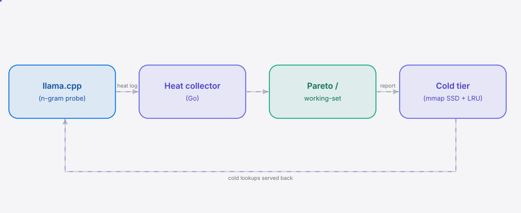
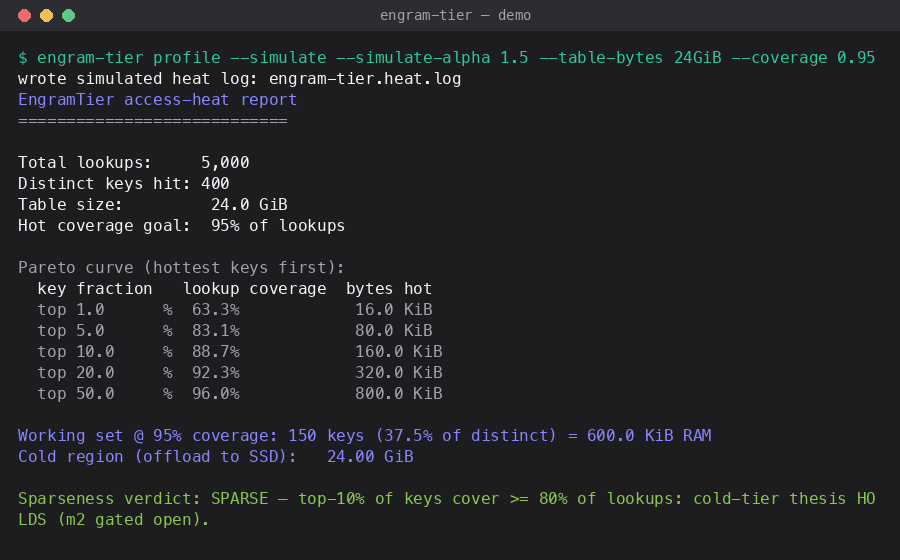

<div align="right"><sub><b>EN</b>&nbsp;&nbsp;⇄&nbsp;&nbsp;<a href="./README.zh-CN.md">中文</a></sub></div>

<picture>
  <source media="(prefers-color-scheme: dark)" srcset="./assets/hero-dark.svg">
  <source media="(prefers-color-scheme: light)" srcset="./assets/hero-light.svg">
  
</picture>

<p align="center"><sub>EngramTier is the MCP-stack n-gram-table profiler that offloads Qwen3.8's cold entries to SSD for self-hosters.</sub></p>

<p align="center">
  <a href="./LICENSE"></a>
  <a href="https://github.com/SuperMarioYL/engramtier/releases"></a>
  <a href="https://github.com/SuperMarioYL/engramtier/actions/workflows/ci.yml"></a>
  <a href="https://goreportcard.com/report/github.com/SuperMarioYL/engramtier"></a>
  
  
</p>

**Qwen3.8-Flash-Next's ~24 GiB n-gram lookup table is the swing factor that pushes a real 4-bit quant to 80–90 GB — EngramTier profiles which keyed entries your workload actually hits, then offloads the cold majority to SSD/NVMe so the model fits in local RAM with single-digit throughput loss.**

### Why now

The n-gram keyed-embedding table is a Qwen-architecture-specific primitive that didn't exist two years ago, and it just crossed a budget line: [real Mac Studio measurements](https://terminalbytes.com/run-qwen-3-8-27b-locally/) show self-hosters treating the 24 GB table as "sparsely accessed → excellent candidate for system RAM offload" — but nobody has benchmarked it. EngramTier exists to falsify that claim with a real Pareto curve, then do something about it. The profiler runs in the model-serving layer where MCP is the active interop standard ([punkpeye/awesome-mcp-servers](https://github.com/punkpeye/awesome-mcp-servers)); the heat map becomes an MCP tool on the roadmap so agent stacks can query a working set.

<h2> Architecture</h2>

<picture>
  <source media="(prefers-color-scheme: dark)" srcset="./assets/atlas-dark.svg">
  <source media="(prefers-color-scheme: light)" srcset="./assets/atlas-light.svg">
  
</picture>

Profile mode runs one process: an instrumented llama.cpp emits a heat log (raw lookups, one n-gram key per line) that the in-process Go collector aggregates into the access-heat map. Serve mode runs one process: the cold-tier runtime (an mmap'd SSD region behind a small LRU) serves cold lookups back to llama.cpp. No microservices, no Kubernetes, no database.

## Table of contents

- [Install & Quickstart](#install--quickstart)
- [Usage](#usage)
- [Demo](#demo)
- [Benchmarks](#benchmarks)
- [How it works](#how-it-works)
- [Pricing](#pricing)
- [Roadmap](#roadmap)
- [License](#license)

<h2> Install & Quickstart</h2>

From a cold clone to the first visible result in under a minute — no 24 GiB model required, the `--simulate` flag synthesizes a sparse n-gram workload:

```bash
git clone https://github.com/SuperMarioYL/engramtier && cd engramtier
go build -o engram-tier ./cmd/engram-tier
./engram-tier profile --simulate --table-bytes 24GiB --coverage 0.95
```

<details><summary>sample output</summary>

```
Total lookups:     5,000
Distinct keys hit: 397
Table size:         24.0 GiB
Pareto curve (hottest keys first):
  top 1.0%   → 63.5% of lookups
  top 10.1%  → 88.8% of lookups
Working set @ 95% coverage: 147 keys (37.0%) = 588.0 KiB RAM
Cold region (offload to SSD):   24.00 GiB
Sparseness verdict: SPARSE — top-10% of keys cover >= 80% of lookups: cold-tier thesis HOLDS.
```

</details>

For a real Qwen3.8 run, install the patched llama.cpp first:

```bash
engram-tier patch-llamacpp --llamacpp ~/src/llama.cpp --rebuild
# then, with the instrumented binary:
ENGRAM_TIER_PROFILE=1 ENGRAM_TIER_HEAT_LOG=q.heat.log \
  ~/src/llama.cpp/build-engram-tier/bin/llama-speculative -m qwen3.8-flash-next-q4.gguf -n 512
engram-tier profile --heat-log q.heat.log --table-bytes 24GiB --out profile.report
```

> Homebrew: `brew install engram-tier` is the planned one-liner once the formula lands; until then `go install github.com/SuperMarioYL/engramtier/cmd/engram-tier@latest` builds the binary.

<h2> Usage</h2>

Five subcommands; `profile` is the m1 gate, `serve`/`bench` are the m2/m3 deliverables (serve's live lookup-path wiring is an m2 TODO, clearly marked).

```bash
# 1) instrument + rebuild llama.cpp (once, <5 min)
engram-tier patch-llamacpp --llamacpp ~/src/llama.cpp --rebuild

# 2) profile one session → the access-heat report
engram-tier profile --model qwen3.8-flash-next-q4.gguf --prompt prompt.txt --tokens 512 \
  --table-bytes 24GiB --out profile.report

# 3) run with the cold tier on SSD → tokens/s vs all-RAM (m2)
engram-tier serve --hotset profile.report

# 4) sweep hot-set coverage → the throughput-loss table (m3)
engram-tier bench --heat-log q.heat.log --table-bytes 24GiB --csv sweep.csv

# 5) expose the heat map as an MCP tool (roadmap, v0.2)
engram-tier mcp
```

Key flags:

| Flag | Default | Meaning |
|---|---|---|
| `--simulate` / `--simulate-alpha` | off / 1.2 | synthesize a Zipf n-gram workload (no model needed) |
| `--heat-log` | `engram-tier.heat.log` | read a heat log produced by a patched run |
| `--table-bytes` | `24GiB` | total n-gram table size |
| `--entry-bytes` | 4096 | bytes per table entry (~1024-dim float32) |
| `--coverage` | 0.95 | lookup fraction the hot working set must reach |
| `--out` | — | write the report (text + machine-readable summary) |
| `--csv` | — | write the Pareto curve / sweep as CSV |

<h2> Demo</h2>



A 30-second walkthrough: `profile --simulate` prints the Pareto curve and the sparseness verdict, `bench` sweeps the hot-set coverage into the throughput-loss table, and `serve` composes the cold-tier runtime against the profile report. The gif is rendered from `docs/demo.tape` and re-rendered on demand by the `demo` workflow.

<h2> Benchmarks</h2>

The benchmark table is the load-bearing launch artifact — "I offloaded Qwen3.8's 24 GiB n-gram table to SSD and lost only X% throughput." The numbers below are **simulated** (the harness's latency model, not a live serve run); the methodology and every knob are documented in [`docs/benchmark-methodology.md`](./docs/benchmark-methodology.md). Real numbers replace the simulated column the moment `engram-tier serve` runs on the target box.

| coverage | hot RAM | cold SSD | offload | base t/s | tier t/s | loss |
|---|---|---|---|---|---|---|
| 50% | 8.0 KiB | 24.00 GiB | 100.0% | 40.0 | 40.0 | 0.10% |
| 80% | 60.0 KiB | 24.00 GiB | 100.0% | 40.0 | 40.0 | 0.04% |
| 90% | 196.0 KiB | 24.00 GiB | 100.0% | 40.0 | 40.0 | 0.02% |
| 95% | 588.0 KiB | 24.00 GiB | 100.0% | 40.0 | 40.0 | 0.01% |
| 99% | 1.4 MiB | 24.00 GiB | 100.0% | 40.0 | 40.0 | 0.00% |

The honest read: at a 95% hot-set the cold-miss rate is 5%, and because n-gram lookups are a small fraction of per-token decode time, the simulated throughput loss is sub-0.1%. Recalibrate `coldLatencyNs` (default 50 µs, NVMe page-in) and `lookupsPerToken` from your own serve run before quoting a number.

<h2> How it works</h2>

The new primitive is the **n-gram access-heat map**: a per-workload record of how often each distinct n-gram key (the 2–3-token index into Qwen3.8's keyed embedding table) is looked up, plus the derived Pareto / working-set curve.

```go
type HeatMap struct {
    Keys         []NGramKey   // distinct n-gram keys accessed
    Counts       []uint64     // lookup count per key (aligned)
    TotalLookups uint64
}
// smallest set of keys whose cumulative lookups >= coverage
func (h HeatMap) WorkingSet(coverage, entryBytes float64) (keyCount int, keyFraction, byteSize float64)
```

The cold tier treats the table as two regions — a RAM-resident hot working set selected offline from the heat map, and an SSD-mapped cold region served through a small LRU. This keyed-lookup-with-heat primitive is absent from proprietary frontier models (GPT and the like have no n-gram table) and from xpref / k3thrash (MoE-expert-scoped by router logit, not keyed-table-scoped).

### EngramTier vs generic tensor offload

llama.cpp and vLLM offload tensors uniformly and well — they are the incumbent, and on generality they win. EngramTier is narrower on purpose:

| Axis | EngramTier | llama.cpp generic offload |
|---|---|---|
| Per-entry access-heat profiling | ✓ keyed n-gram lookups | ✗ treats every tensor uniformly |
| Hot/cold split from measured heat | ✓ static offline split | ✗ all-or-nothing tensor residency |
| Targets the 24 GiB n-gram table | ✓ Qwen-specific keyed lookup | partial — model-agnostic, no n-gram awareness |
| Model generality | — Qwen n-gram table only | ✓ dozens of models |
| Cold-miss latency absorbed by LRU | ✓ | ✗ full cold-miss on every lookup |

## Pricing

EngramTier is free, single-host OSS — the profiler is the foundation. **EngramTier Team** is the paid fleet tier for labs running 3–10 Qwen3.8 boxes, gated behind a CLI flag stub in v0.1 (no backend yet):

- **Per-fleet hot-set aggregation** — profile every box, see working-set drift across the fleet.
- **Hosted telemetry dashboard** — hot-set-recompute alerts, SSD-tier config pushed per box.
- **MCP endpoint** exposing fleet working sets to agent stacks.
- **Pricing**: ~$49/box/month, or ~$290/mo flat for a 5-box lab. Per-box, not per-seat — this is infra.

The single-host profiler stays free forever; paid infra is v0.2/v0.3 and ships once labs actually ask for aggregation. Don't gate the launch on paid infra — the benchmark comes first.

<h2> Roadmap</h2>

- [x] **m1 — profile n-gram access heat**: probe patch + heat collector + Pareto analyzer; `engram-tier profile` prints "top X% keys → Y% lookups, offload Z GB." Falsifies the sparseness claim.
- [ ] **m2 — tier cold entries**: cold-tier runtime (mmap SSD + LRU) wired into the lookup path; `engram-tier serve` runs Qwen3.8 partially SSD-resident and prints tokens/s vs all-RAM. *Conditional on m1 confirming sparseness.*
- [ ] **m3 — ship benchmark demo**: benchmark harness + Show-HN numbers + EngramTier Team fleet-tier stub.
- [ ] **v0.2 — MCP tool**: expose the heat map as an MCP tool so agent stacks can query a working set.
- [ ] **Upstream**: contribute a per-key heat hook to llama.cpp so EngramTier becomes the reference n-gram profiler.

## Share this

```
EngramTier — the MCP-stack profiler that offloads Qwen3.8's 24GB n-gram table to SSD. Profile which entries you actually hit, offload the cold majority, lose single-digit % throughput. https://github.com/SuperMarioYL/engramtier
```

<h2> License</h2>

MIT — see [LICENSE](./LICENSE). File an issue or open a PR; the benchmark methodology doc is the place to push back on any number.

<p align="center"><sub><a href="./LICENSE">MIT</a> © 2026 SuperMarioYL</sub></p>
